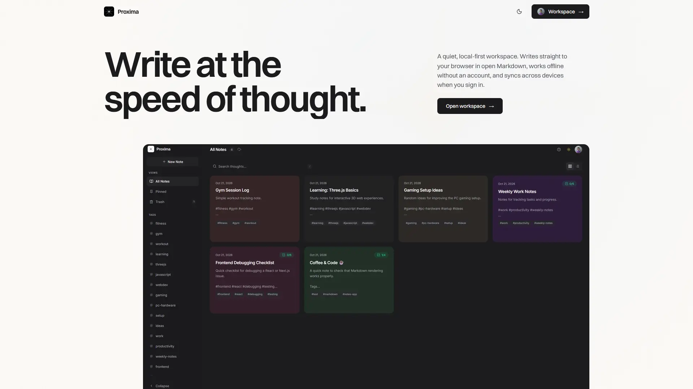

<div align="center">
  
  <h1>Proxima</h1>
  <p><strong>Quiet, Local-First Markdown Workspace for Focused Thinkers</strong></p>
  <p>
    <a href="https://proxima.vinodjangid.site"><strong>proxima.vinodjangid.site »</strong></a>
  </p>

  <p>
    
    
    
    
    
    
  </p>
</div>

<br />

<p align="center">
  
</p>

<br />

## Overview

**Proxima** is a quiet, distraction-free, local-first note-taking workspace designed for speed, privacy, and longevity. It eliminates loading spinners, bloated databases, and proprietary paywalls by storing your words as pure UTF-8 GitHub Flavored Markdown directly in on-device storage.

Whether drafting offline on a flight or syncing across devices in real time, Proxima ensures your thoughts belong entirely to you—instantly accessible in under 14 milliseconds, fully compatible with Obsidian and VS Code, and completely free from account barriers.

---

## Key Features

### ⚡ Local-First Engine & Zero Latency
- **Direct IndexedDB Persistence**: Every stroke writes instantly to local Dexie.js storage before any network request occurs.
- **Sub-14ms Reads**: Read and write thoughts straight from memory cache with zero API round-trip delay.
- **100% Offline Capability**: Create, edit, tag, search, and manage notes anywhere without an active internet connection.

### 🔄 Quiet Cloud Synchronization
- **Guest-First Architecture**: Start drafting immediately without creating an account.
- **Automated Account Migration**: Local guest notes automatically transfer to your secure account when you sign in via Google OAuth or Email.
- **Multi-Device Sync**: Silent, real-time synchronization backed by Cloud Firestore whenever connectivity is restored.

### 📝 Pure Markdown & Zero Lock-In
- **Standard Syntax**: Writes in plain UTF-8 GitHub Flavored Markdown (GFM) with real-time rendering.
- **Side-by-Side Drafting**: Switch smoothly between raw markdown, split preview, and rendered output.
- **Full Data Sovereignty**: Export your entire note collection at any time as raw `.md` files or structured JSON with zero export gates.

### ⌨️ Muscle Memory & Keyboard Chords
- **Universal Command Palette**: Trigger `⌘K` / `Ctrl+K` to search notes, create documents, switch themes, or export data.
- **Instant Search**: Tap `/` from anywhere to trigger real-time fuzzy filtering powered by Fuse.js.
- **Dedicated Chords**: Expand to Zen mode (`Alt+Z`), quickly append tasks (`Alt+T`), or navigate lists without leaving the keyboard.

### 🎨 Tonal Moods & Zen Focus
- **Calibrated Grounds**: Choose from nine designer-curated pastel and obsidian surfaces calibrated for sunlit paper and midnight focus.
- **Zen Expansion**: Strip away headers, sidebars, and UI clutter to focus entirely on uninterrupted writing.
- **Clean Tagging & Pinning**: Organize thoughts with lightweight hashtags and pin priority notes to the top of your workspace.

---

## Technical Architecture

```
proxima-notes/
├── public/                 # Static assets, self-hosted WOFF2 fonts & preview media
│   └── fonts/              # Switzer & Zodiak typography
├── scripts/                # Static pre-rendering & build pipeline
│   └── prerender.mjs       # Headless Playwright static page prerenderer
├── src/
│   ├── components/
│   │   ├── Home/           # Editorial landing page stages & interactive showcases
│   │   ├── Notes/          # Note grid, cards, editor canvas & modal handlers
│   │   └── common/         # Theme toggles, command palette & toast notifications
│   ├── context/            # Authentication & notes state providers
│   ├── data/               # Editorial content & color tone definitions
│   ├── engine/             # WebGL diffraction shader & GSAP reveal engine
│   ├── hooks/              # Custom React hooks (keyboard shortcuts, PWA)
│   ├── lib/                # Firebase auth, modular Firestore & Dexie IndexedDB
│   ├── routes/             # Client routes (Home, Notes, Profile, Legal, Auth)
│   └── services/           # Note lifecycle CRUD, sync streams & export utilities
├── index.html              # Zero-FOUC HTML shell with critical canvas script
└── vite.config.js          # Vite configuration with Tailwind CSS v4 & PWA plugin
```

---

## Tech Stack

| Layer | Technology |
| :--- | :--- |
| **Core Framework** | React 19, Vite 8, React Router 7 |
| **Styling & Design** | Tailwind CSS v4, Switzer & Zodiak typography |
| **Local Storage** | Dexie.js (IndexedDB wrapper) |
| **Cloud & Auth** | Firebase Authentication, Cloud Firestore |
| **Motion & Graphics** | GSAP 3 (ScrollTrigger, SplitText), OGL (WebGL), Lenis |
| **Markdown & Parsing** | Marked.js, DOMPurify |
| **Search Engine** | Fuse.js (Sub-millisecond fuzzy matching) |
| **PWA & Offline** | Vite PWA Plugin, Workbox Service Worker |
---

## Author & Credits

Built & designed with care by [<u>Vinod Jangid</u>](https://vinodjangid.site).
